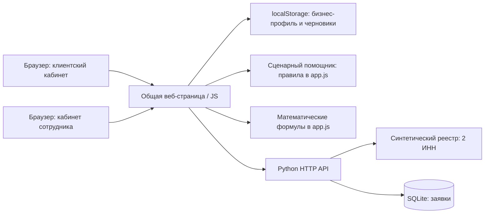

# Архитектурная схема — фактически реализованный демонстрационный прототип

**Контуры реализованы так:** один Docker-контейнер с Python-сервером и статическими файлами. Клиент и сотрудник — две роли внутри интерфейса. Заявки передаются на локальный API и хранятся в SQLite; браузер дополнительно сохраняет профиль и черновики локально. Обновления между открытыми вкладками/браузерами проверяются периодическим запросом.

**Не реализовано:** строгая банковская идентификация, защищённая авторизация, централизованный аудит, одновременные транзакции с разрешением конфликтов, настоящие ФНС/БКИ, обработка реальных кредитных историй, LLM с открытыми весами, реальный выпуск кредита или договорная подпись. Это границы демо, а не готовое enterprise-решение.
