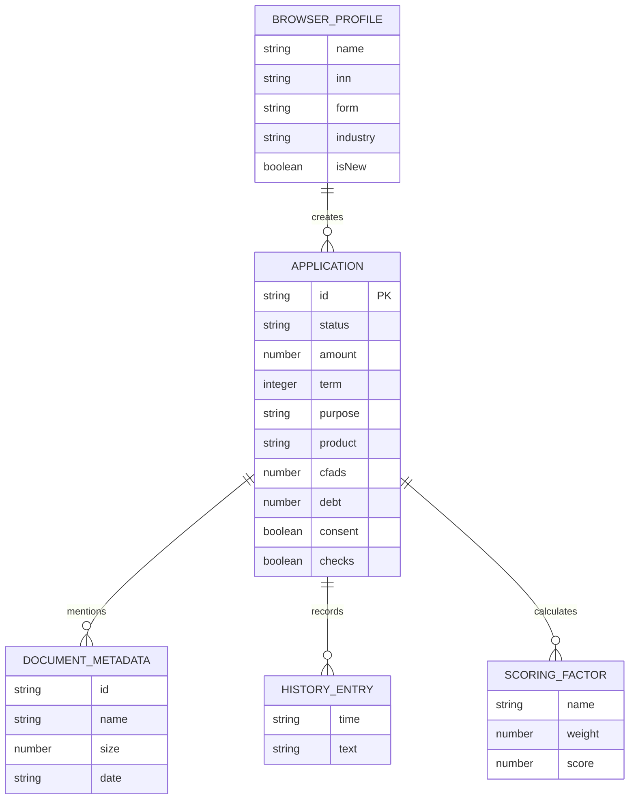

# Модель данных — демонстрационная версия

- На сервере одна таблица SQLite `applications`: `id TEXT PRIMARY KEY`, `payload TEXT NOT NULL`, `updated_at TEXT NOT NULL`.
- Досье хранится как JSON-снимок, содержащий профиль, цель, параметры, статусы, историю и метаданные документов.
- Локально в браузере `localStorage['alfa-bolshe-v1']` содержит данные проекта, финансовую модель, проекты, черновики и копии заявок. Раздел паспорта использует `state.passports`, в котором каждое поле имеет `value`, `source` и необязательный `period`.
- Все источники и показатели из API компании синтетические; пользователь может внести сведения сам.
- Серверное хранилище общедоступно любому, кто может обратиться к демо API. Реальные персональные данные запрещены.
