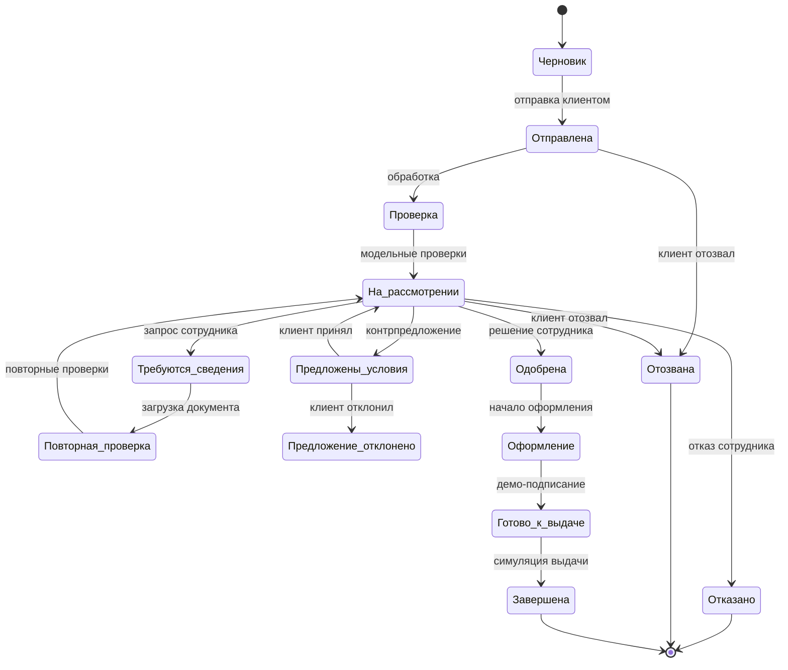

# Диаграмма состояний заявки

Диаграмма отражает ветвления клиентской демо-логики из `app.js`. Некоторые промежуточные шаги отображаются как `stage`, другие — как строковый `status`; это следует учитывать при изменении логики.

**Проверки решения:** для демонстрационного одобрения требуется согласие, выполненные синтетические проверки, подтверждение полноты документов, DSCR не ниже заданного порога 1,3 и соответствие числовым ограничениям выбранного аннуитетного продукта. Для нового незарегистрированного бизнеса предусмотрена блокировка одобрения.

**Ограничение:** система не реализует полноценный workflow engine, банковские maker-checker полномочия или серверную проверку переходов; переходы выполняет пользовательский JavaScript с сохранением синтетической заявки.
